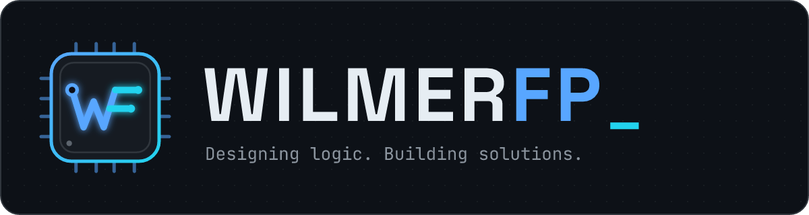
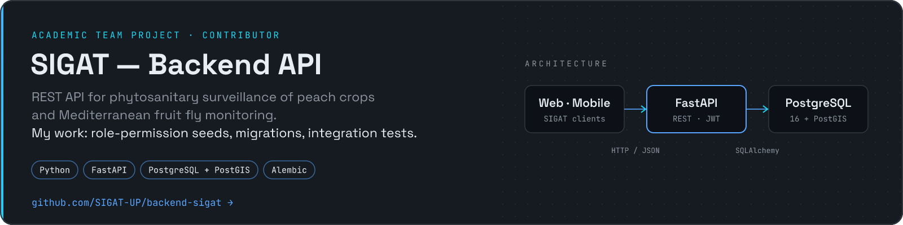

  

  <picture>
    <source media="(prefers-color-scheme: dark)" srcset="assets/logo-transparent.png">
    
  </picture>

<h3 align="center">Wilmer Flórez</h3>

  <b>Backend Developer in progress</b> · Systems Engineering Student · Colombia 
  Desarrollador backend en formación · Estudiante de Ingeniería de Sistemas · Colombia

  <code>Backend</code>&nbsp;
  <code>REST APIs</code>&nbsp;
  <code>Databases</code>&nbsp;
  <code>Software Architecture</code>&nbsp;
  <code>ES · EN</code>

<b><i>Designing logic. Building solutions.</i></b> Engineering ideas into software.

## About me · Sobre mí

**EN** — I'm a Systems Engineering student from Colombia focused on the backend: APIs, relational databases and the architecture that holds them together. I learn by building, and this profile is where that work becomes public, one repository at a time.

**ES** — Soy estudiante de Ingeniería de Sistemas en Colombia, enfocado en el backend: APIs, bases de datos relacionales y la arquitectura que las sostiene. Aprendo construyendo, y este perfil es donde ese trabajo se vuelve público, un repositorio a la vez.

## Backend development · Desarrollo backend

What I have actually worked on, in real code:

- **Database migrations & seed data** — Alembic migrations on PostgreSQL, including a role-based permission matrix. Migraciones y datos semilla con Alembic sobre PostgreSQL, incluida una matriz de permisos por rol.
- **Integration testing** — pytest suites that run against a real database. Pruebas de integración con pytest contra una base de datos real.
- **REST APIs in a layered architecture** — FastAPI service with typed contracts, contributed to as part of a team. APIs REST con FastAPI en una arquitectura por capas, como parte de un equipo.
- **Relational modeling** — from entity-relationship models to SQL schemas. Modelado relacional: de modelos entidad-relación a esquemas SQL.

## Tech stack · Tecnologías

### Languages & backend

### Databases · Bases de datos

 &nbsp; <b>PostgreSQL</b> · PostGIS · SQL · SQLAlchemy · Alembic

### Tools & technologies · Herramientas

 &nbsp; pytest · Jupyter · NumPy · pandas

Only tools I have used in real code are listed: public commits (Python, FastAPI, PostgreSQL, SQL, Alembic, pytest, Git) or academic projects (Node.js, Express, JavaScript, Java, C with OpenMP, Jupyter). The list grows as public repositories land. 
Solo aparecen herramientas usadas en código real: commits públicos o proyectos académicos. La lista crecerá con cada repositorio público.

## Featured projects · Proyectos destacados

**SIGAT — Backend API** · Academic team project · Contributor 
**EN** — REST API for phytosanitary surveillance of peach crops and Mediterranean fruit fly monitoring. I contributed the role-permission seed migration, scenario classification migration and integration-test fixes. 
**ES** — API REST para la vigilancia fitosanitaria del cultivo de durazno y el seguimiento de la mosca del Mediterráneo. Aporté la migración de permisos por rol, la clasificación por escenarios y ajustes a las pruebas de integración.

More public repositories are on the way, each following the <a href="docs/PROJECT_TEMPLATE.md">WILMERFP project standard</a>. · Más repositorios públicos en camino.

<!--
  ┌─ ADD A PROJECT ────────────────────────────────────────────────────────────┐
  │ 1. Add an entry to data/projects.json                                      │
  │ 2. npm run build:assets  → assets/cards/<id>.png                          │
  │ 3. Copy this block above the "More public repositories" line:             │
  └────────────────────────────────────────────────────────────────────────────┘

**PROJECT NAME** · Personal project 
**EN** — What it does and the problem it solves, in one sentence. 
**ES** — Qué hace y qué problema resuelve, en una frase.
-->

<table>
  <tr>
    <td width="50%" valign="top">

### Learning · Aprendiendo

- Layered architecture for APIs Arquitectura por capas para APIs
- Async SQLAlchemy & spatial data with PostGIS SQLAlchemy asíncrono y datos espaciales
- Automated testing & CI with GitHub Actions Pruebas automatizadas e integración continua
- Parallel computing with OpenMP Computación paralela con OpenMP

</td>
    <td width="50%" valign="top">

### Goals · Objetivos

- Become a solid backend developer Convertirme en un desarrollador backend sólido
- Publish well-documented, tested repositories Publicar repositorios documentados y probados
- Contribute to open-source projects Contribuir a proyectos de código abierto
- Keep learning and growing in tech Seguir aprendiendo y creciendo

</td>
  </tr>
</table>

## GitHub stats · Estadísticas

<picture>
  <source media="(max-width: 600px)" srcset="assets/stats-mobile.png">
  
</picture>

Real data from the GitHub GraphQL API, regenerated by this repository's own <a href=".github/workflows/stats.yml">workflow</a> — no third-party stats service. · Datos reales de la API de GitHub.

## Contact · Contacto

  
  

Open to collaborating on backend and database projects, and to feedback on my code. 
Abierto a colaborar en proyectos de backend y bases de datos, y a recibir retroalimentación sobre mi código.

 

