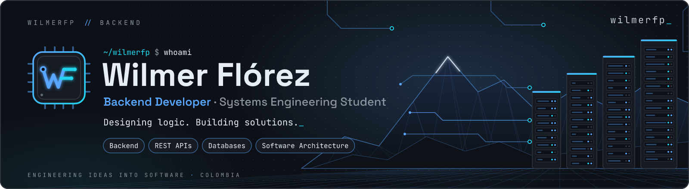
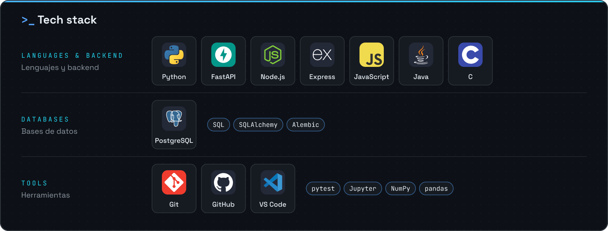
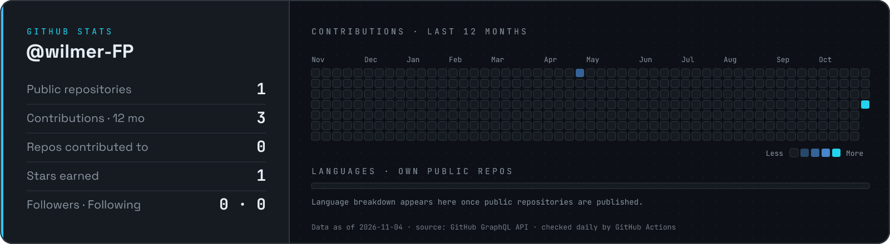
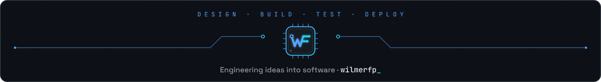

  

  <picture>
    <source media="(prefers-color-scheme: dark)" srcset="assets/logo-transparent.png">
    
  </picture>

<h3 align="center">Wilmer Flórez</h3>

  <b>Backend Developer in progress</b> · Systems Engineering Student · Colombia 
  Desarrollador backend en formación · Estudiante de Ingeniería de Sistemas · Colombia

  <code>Backend</code>&nbsp;
  <code>REST APIs</code>&nbsp;
  <code>Databases</code>&nbsp;
  <code>Software Architecture</code>&nbsp;
  <code>ES · EN</code>

<b><i>Designing logic. Building solutions.</i></b> Engineering ideas into software.

## About me · Sobre mí

**EN** — I'm a Systems Engineering student from Colombia focused on the backend: APIs, relational databases and the architecture that holds them together. I learn by building, and this profile is where that work becomes public, one repository at a time.

**ES** — Soy estudiante de Ingeniería de Sistemas en Colombia, enfocado en el backend: APIs, bases de datos relacionales y la arquitectura que las sostiene. Aprendo construyendo, y este perfil es donde ese trabajo se vuelve público, un repositorio a la vez.

## Backend development · Desarrollo backend

What I work on, from coursework and hands-on practice:

- **REST APIs** — designing endpoints and typed contracts with FastAPI and Express. Diseño de endpoints y contratos tipados con FastAPI y Express.
- **Relational databases** — modeling from entity-relationship diagrams to SQL schemas on PostgreSQL. Modelado relacional: de diagramas entidad-relación a esquemas SQL en PostgreSQL.
- **Schema migrations** — versioning database changes with Alembic. Versionado de cambios en la base de datos con Alembic.
- **Testing** — automated tests with pytest. Pruebas automatizadas con pytest.

## Tech stack · Tecnologías

<picture>
  <source media="(max-width: 600px)" srcset="assets/stack-mobile.png">
  
</picture>

Only technologies I have used in academic and hands-on work are listed; the panel grows with each public repository. · Solo aparecen tecnologías que he usado en trabajo académico y práctico; el panel crecerá con cada repositorio público.

## Featured projects · Proyectos destacados

**EN** — My first public repositories are in progress. Each one will land here with its architecture, stack and tests, following the <a href="docs/PROJECT_TEMPLATE.md">WILMERFP project standard</a>. 
**ES** — Mis primeros repositorios públicos están en preparación. Cada uno aparecerá aquí con su arquitectura, tecnologías y pruebas.

<!--
  ┌─ ADD A PROJECT ────────────────────────────────────────────────────────────┐
  │ 1. Add an entry to data/projects.json                                      │
  │ 2. npm run build:assets  → assets/cards/<id>.png                          │
  │ 3. Replace the "first public repositories are in progress" text with:     │
  └────────────────────────────────────────────────────────────────────────────┘

**PROJECT NAME** · Personal project 
**EN** — What it does and the problem it solves, in one sentence. 
**ES** — Qué hace y qué problema resuelve, en una frase.
-->

<table>
  <tr>
    <td width="50%" valign="top">

### Learning · Aprendiendo

- Layered architecture for APIs Arquitectura por capas para APIs
- Async SQLAlchemy & spatial data with PostGIS SQLAlchemy asíncrono y datos espaciales
- Automated testing & CI with GitHub Actions Pruebas automatizadas e integración continua
- Parallel computing with OpenMP Computación paralela con OpenMP

</td>
    <td width="50%" valign="top">

### Goals · Objetivos

- Become a solid backend developer Convertirme en un desarrollador backend sólido
- Publish well-documented, tested repositories Publicar repositorios documentados y probados
- Contribute to open-source projects Contribuir a proyectos de código abierto
- Keep learning and growing in tech Seguir aprendiendo y creciendo

</td>
  </tr>
</table>

## GitHub stats · Estadísticas

<picture>
  <source media="(max-width: 600px)" srcset="assets/stats-mobile.png">
  
</picture>

Real data from the GitHub GraphQL API, regenerated by this repository's own <a href=".github/workflows/stats.yml">workflow</a> — no third-party stats service. · Datos reales de la API de GitHub.

## Contact · Contacto

  
  

Open to collaborating on backend and database projects, and to feedback on my code. 
Abierto a colaborar en proyectos de backend y bases de datos, y a recibir retroalimentación sobre mi código.

 

