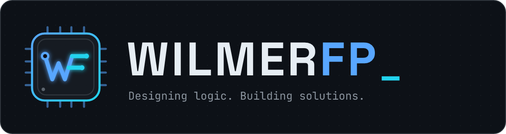

# WILMERFP — Guía de identidad visual

> **Designing logic. Building solutions.** · *Engineering ideas into software.*

Concepto: **Dark Tech / Futuristic Software Architecture**. La marca representa a un desarrollador backend: lógica, datos y sistemas conectados. Todo elemento visual debe sugerir *estructura* (circuitos, nodos, servidores, grids), nunca decoración gratuita.

---

## 1. Logo y monograma

| Pieza | Archivo | Uso |
|---|---|---|
| Logo completo (placa oscura) | `assets/logo.png` | README, documentos, fondos claros |
| Logo transparente | `assets/logo-transparent.png` | Sólo sobre fondos oscuros (`#0D1117` / `#161B22`) |
| Monograma | `assets/monogram.png` (512 px) | Favicon, iconos, marcas de agua |
| Avatar | `assets/avatar.png` (460 px) | Foto de perfil de GitHub u otras redes |
| Fuentes SVG editables | `assets/src/*.svg` | Base para nuevas piezas |

**Construcción del monograma.** Una **W** cuyo último trazo funciona como el fuste inclinado de una **F**: las dos letras comparten una línea, igual que dos servicios comparten un contrato. Los brazos de la F terminan en *pads* de circuito (cian) y el inicio de la W es un nodo de entrada. Todo va dentro de un **chip** con pines en los cuatro lados.

- **W** → `Primary #58A6FF` · **brazos F y pads** → `Accent #22D3EE` · chip → `Surface #161B22` con borde degradado Primary→Accent.
- **Área de respeto:** como mínimo el 25 % del ancho del monograma a cada lado.
- **Tamaño mínimo:** 32 px de ancho (monograma) · 180 px (logo completo).

**Wordmark.** `WILMER` en Text + `FP` en Primary + cursor `_` en Accent. El cursor es parte de la marca: indica "en construcción, siempre aprendiendo".

**No hacer:** recolorear el monograma fuera de la paleta · rotarlo o deformarlo · poner el logo transparente sobre fondos claros · añadir sombras o efectos 3D · separar la W de la F.

## 2. Paleta

| Token | Hex | Rol |
|---|---|---|
| `bg` | `#0D1117` | Fondo principal |
| `surface` | `#161B22` | Tarjetas, paneles, chips |
| `border` | `#30363D` | Bordes y separadores (neutral de apoyo) |
| `primary` | `#58A6FF` | Marca, enlaces, trazos de circuito, títulos destacados |
| `accent` | `#22D3EE` | Detalles puntuales: cursor, pads, estados activos |
| `text` | `#E6EDF3` | Texto principal |
| `muted` | `#8B949E` | Texto secundario, etiquetas |

**Proporción recomendada:** 70 % fondos (bg/surface) · 20 % texto · 8 % primary · 2 % accent. El cian es un acento: si aparece en todas partes deja de destacar.

Gradiente de marca: `primary → accent` a 45°. Usarlo sólo en bordes finos, barras de acento y el chip del monograma.

## 3. Tipografía

| Rol | Fuente | Pesos | Uso |
|---|---|---|---|
| Display / UI | **Space Grotesk** | 400 · 500 · 600 · 700 | Nombres, títulos, descripciones |
| Código / etiquetas | **JetBrains Mono** | 400 · 500 · 700 | Etiquetas en mayúsculas espaciadas, chips, comandos, cifras |

Ambas son libres (SIL Open Font License) y se instalan con el proyecto (`npm install`), así que los PNG se renderizan igual en cualquier máquina o en CI.

- Etiquetas de sección: JetBrains Mono, MAYÚSCULAS, `letter-spacing` 3–5 px, color `muted` o `accent`.
- Títulos: Space Grotesk 700, color `text`.
- Nunca más de dos pesos por pieza además de las etiquetas mono.

## 4. Elementos gráficos

| Elemento | Descripción | Dónde está |
|---|---|---|
| **Trazas de circuito** | Líneas ortogonales con quiebres a 45° y un *pad* circular al final | `trace()` en `scripts/brand.mjs` |
| **Grid de puntos** | Retícula de 22–24 px, opacidad 10–16 % | `dotGrid()` |
| **Chips** | Píldoras `surface` con borde `primary` al 55 % y texto mono | `chip()` / `chipRow()` |
| **Racks de servidores** | Columnas con unidades, barras de actividad y LEDs | banner |
| **Cordillera wireframe** | Silueta montañosa (referencia andina) con triangulación sutil | banner |
| **Divisor** | Línea con degradado y nodo romboidal central | `assets/divider.png` |

Reglas: las trazas siempre "conectan" algo (texto → servidor, logo → borde); nunca líneas sueltas. Bordes redondeados: 18–22 px en piezas grandes, 12 px en cajas internas.

## 5. Piezas del sistema

| Pieza | Tamaño | Generada por |
|---|---|---|
| Banner de perfil | 1600 × 440 | `npm run build:assets` |
| Logo / logo transparente | 1200 × 320 | `npm run build:assets` |
| Monograma / avatar | 512 × 512 / 460 × 460 | `npm run build:assets` |
| Tarjetas de proyecto | 1600 × 400 | `npm run build:assets` (desde `data/projects.json`) |
| Tarjeta de estadísticas | 1600 × 440 | `npm run build:stats` (datos reales de la API de GitHub) |
| Banner de proyecto | 1600 × 360 | `npm run project-banner -- --name ".."` |
| Footer | 1600 × 220 | `npm run build:assets` |

Todos los colores y fuentes salen de `scripts/brand.mjs`: cambiar un token ahí actualiza todas las piezas al reconstruir.

## 6. Voz y tono

- **Precisa y honesta.** Describir lo que se ha hecho, con verbos concretos ("aporté la migración de permisos por rol"), sin superlativos ni "experto en".
- **Bilingüe.** Inglés como idioma principal en títulos; español como línea secundaria (``) o párrafo paralelo. Nunca traducir nombres de tecnologías.
- **Corta.** Una idea por línea. Si un párrafo pasa de tres líneas, se divide o se recorta.
- **Sin emojis** en títulos ni listas; la iconografía la aportan el monograma y los iconos de tecnologías.
- **Evidencia primero.** Ninguna tecnología, cifra o proyecto aparece sin respaldo verificable (ver `PROFILE_CONTENT.md`).
