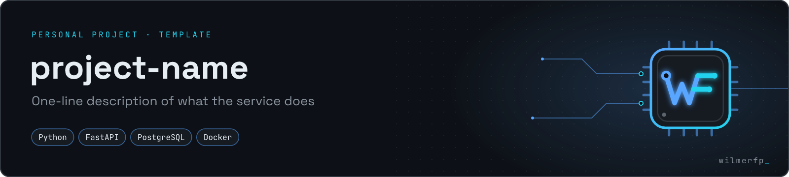

# WILMERFP project standard

Checklist para que cada repositorio nuevo se vea y se comporte como parte de la misma marca. Plantilla de README: [`templates/README_TEMPLATE.md`](../templates/README_TEMPLATE.md).



## 1. Antes de crear el repositorio

- **Nombre:** `kebab-case`, descriptivo y en inglés: `inventory-api`, `sql-modeling-notes`. Nada de `proyecto-final-2`.
- **Descripción (About):** una frase, qué hace + stack. Ej.: *"REST API for library loans — FastAPI + PostgreSQL"*.
- **Topics:** 3–6, en minúsculas: `backend`, `fastapi`, `postgresql`, `rest-api`, `academic-project` (si aplica).
- **Visibilidad:** público sólo si no contiene credenciales, datos personales ni material que la universidad no permita publicar.
- **Licencia:** MIT para código propio; ninguna (todos los derechos reservados) si es trabajo académico con restricciones.

## 2. Estructura mínima

```text
repo/
├── README.md            ← desde templates/README_TEMPLATE.md
├── docs/
│   ├── banner.png       ← npm run project-banner (en github-identity)
│   └── architecture.md  ← diagrama + decisiones (opcional)
├── src/                 ← código
├── tests/               ← pruebas
├── .env.example         ← variables SIN valores reales
├── .gitignore
└── LICENSE
```

## 3. Banner del proyecto

Desde la carpeta `github-identity`:

```bash
npm run project-banner -- --name "inventory-api" --tagline "Stock control REST API with audit trail" --stack "Python,FastAPI,PostgreSQL" --type "PERSONAL PROJECT" --out ../inventory-api/docs/banner.png
```

`--type` sugeridos: `PERSONAL PROJECT` · `ACADEMIC PROJECT` · `ACADEMIC TEAM PROJECT · CONTRIBUTOR` · `OPEN SOURCE CONTRIBUTION`.

## 4. Calidad antes de publicar

- [ ] El README explica qué hace, cómo ejecutarlo y cómo probarlo en menos de un minuto de lectura.
- [ ] `git log` no contiene `.env`, contraseñas, tokens ni bases de datos con datos reales.
- [ ] Hay al menos una prueba automatizada o una sección "Cómo verificar".
- [ ] Commits con formato *Conventional Commits*: `feat:`, `fix:`, `test:`, `docs:`, `refactor:`, `chore:`.
- [ ] Capturas o diagramas sólo si aportan; nunca capturas de pantalla completas como portada.
- [ ] Si es trabajo en equipo, el README nombra al equipo y deja claro tu aporte.

## 5. Añadirlo al perfil

1. Añade una entrada a `data/projects.json` (copia la de SIGAT y cambia los campos; `flow` es opcional y dibuja el mini diagrama de arquitectura).
2. `npm run build:assets` → genera `assets/cards/<id>.png`.
3. En `README.md`, copia el bloque comentado `ADD A PROJECT` encima de la línea *"More public repositories are on the way"*.
4. Si el proyecto añade una tecnología nueva, muévela de "pendiente" a "verificada" en `docs/PROFILE_CONTENT.md` y añádela a *Tech stack*.
5. Máximo **4 proyectos destacados**. Cuando haya más, usa los *Pinned repositories* de GitHub y deja aquí sólo los mejores.
