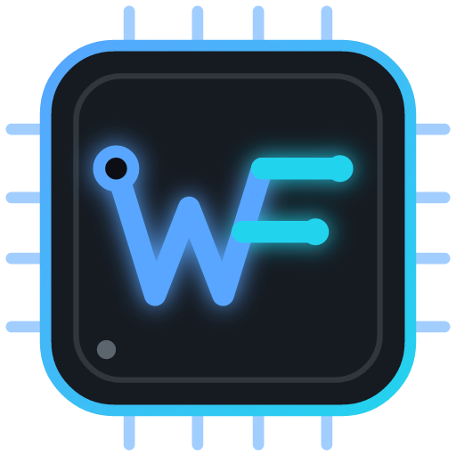

<!--
  WILMERFP project README template.
  1. Generate the banner:  npm run project-banner -- --name "..." --out ../REPO/docs/banner.png
  2. Replace every UPPERCASE placeholder. Delete sections that do not apply —
     an honest short README beats a long empty one.
-->

<p align="center">
  
</p>

<p align="center">
  <b>ONE_LINE_DESCRIPTION</b><br>
  <sub>DESCRIPCIÓN_EN_UNA_LÍNEA</sub>
</p>

<p align="center">
  <code>PROJECT_TYPE</code>&nbsp; <code>STACK_1</code>&nbsp; <code>STACK_2</code>&nbsp; <code>STACK_3</code>
</p>

## Overview <sub>· Resumen</sub>

**EN** — What problem this solves, for whom, and what makes the approach interesting. Two or three sentences.

**ES** — Qué problema resuelve, para quién y qué tiene de interesante el enfoque. Dos o tres frases.

<!-- Team project? Keep this line; delete it otherwise. -->
> Academic team project by TEAM_NAME. **My contribution:** WHAT_YOU_BUILT.

## Features <sub>· Funcionalidades</sub>

- **FEATURE** — short explanation.
- **FEATURE** — short explanation.
- **FEATURE** — short explanation.

## Architecture <sub>· Arquitectura</sub>

```text
client ──HTTP/JSON──▶ API (FRAMEWORK) ──ORM──▶ DATABASE
                         │
                         └──▶ EXTERNAL_SERVICE (optional)
```

| Layer | Responsibility | Tech |
|---|---|---|
| API | Routing, validation, auth | FRAMEWORK |
| Domain | Business rules | LANGUAGE |
| Data | Persistence, migrations | DATABASE · MIGRATION_TOOL |

## Getting started <sub>· Cómo ejecutarlo</sub>

**Requirements:** LANGUAGE_VERSION · DATABASE_VERSION · (Docker, optional)

```bash
git clone https://github.com/wilmer-FP/REPO.git
cd REPO
cp .env.example .env        # fill in local values — never commit .env
INSTALL_COMMAND
RUN_COMMAND
```

The API is available at `http://localhost:PORT` · docs at `http://localhost:PORT/docs`.

## Tests <sub>· Pruebas</sub>

```bash
TEST_COMMAND
```

## API <sub>· Endpoints</sub>

| Method | Path | Description |
|---|---|---|
| `GET` | `/health` | Service status |
| `POST` | `/RESOURCE` | Create RESOURCE |

## Roadmap

- [ ] NEXT_STEP
- [ ] NEXT_STEP

## License

LICENSE_NAME — see [LICENSE](LICENSE).

---

<p align="center">
  <a href="https://github.com/wilmer-FP"></a><br>
  <sub>Built by <a href="https://github.com/wilmer-FP">Wilmer Flórez</a> · Designing logic. Building solutions.</sub>
</p>
